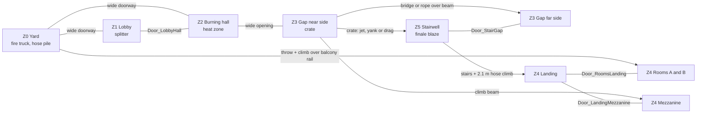
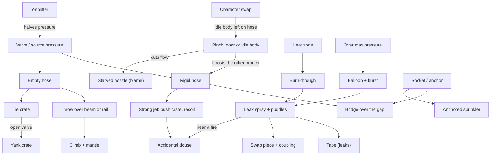

# Flame & Blame — Hose System Design Doc

Source of truth: https://claude.ai/artifact/25BaRzKnSzxLpxwA9tV63G (synced 2026-11-26)

## Overview

The demo is one playable Unity scene built around a single modular fire hose system, where one variable, water pressure, decides how the hose behaves. The hose puts out fires, carries players, moves objects and causes chaos, so the player solves different kinds of problems with one tool.

It answers the test brief: take a mechanic from the Flame and Blame trailer, or invent one, and build it as a system, not a one-off effect. The demo has to be funny, readable at a glance, feel like co-op chaos, respond to every player action, interact with other objects and systems, and run without breaking or freezing.

Design pillars:

- **One system, many problems.** Firefighting, getting places and moving things are all solved with the same hose.
- **One rule to learn.** Pressure sets stiffness and force. Everything else follows from it.
- **Physical and floppy.** The hose is a jelly-like rope that reacts to everything: players, doors, fire, water.
- **Lego-like but readable.** A few parts snap together. Each part does one obvious thing.
- **Ridiculous by design.** Thumb over the nozzle, hoses thrashing like snakes, balloon bursts, teammates standing on your hose.
- **Rock solid.** The demo never explodes, jitters or freezes while someone plays it.

## Core rule: pressure = stiffness + force

Pressure at any point in the hose sets two things: how stiff the hose is there, and how hard water pushes out of the nozzle. Players learn this one dial and work out the rest themselves.

| State | Pressure | Hose behaviour | What players use it for |
| --- | --- | --- | --- |
| Empty | 0 | Floppy rope, drags on the floor | Throw it, lasso, tie objects, climb it as a rope |
| Low | Below ~40% | Semi-stiff, wobbly jelly | Spray water, put out fires, light pushes |
| High | ~40–100% | Rigid pole, strong recoil | Bridge over gaps, push heavy objects, jet the player around |
| Over limit | Above the hose's max | Bulges into a balloon, shakes, then pops | Nothing good: it leaks, whips around and needs tape |

The percentages are starting values for tuning, not final numbers. Each hose type has its own max pressure, so the same source can be fine for a thick hose and burst a thin one.

## System components

The demo has seven part types. Each one does one obvious thing, so a player can read a hose network at a glance.

| Part | What it does | Key properties |
| --- | --- | --- |
| Thin hose | Light, long, carried by one player | Low max pressure, bursts easily |
| Thick hose | Heavy, carries high pressure | Needs two players, or one player drags it slowly |
| Universal coupling | Joins any two hose ends | Snaps on with a satisfying pop; can be pulled apart by force |
| Y-splitter | Splits one line into two | Each output gets half the pressure |
| Source (hydrant, fire truck) | Feeds water into the network | Source pressure set at its valve; stationary |
| Valve (on the source) | Turns the water on or off and sets source pressure | Operated by a player, usually not the one holding the nozzle |
| Nozzle | The hose's working end | Aimed by the holder; applies recoil |

Two player-made modifiers sit on top of the parts:

- **Thumb over the nozzle.** Covering part of the opening raises pressure at the tip, per player. It's the signature move: funny, physical and it teaches pressure without any text.
- **Tape.** A quick fix that joins two cut ends or patches a burst. It always leaks a little, losing pressure and making puddles that become someone else's problem.

Hose length is a property of each piece, not a separate type. Pieces come in a few fixed lengths.

## Player actions

Every action uses the same hose, and each one depends on the current pressure.

| Action | Needs | Result |
| --- | --- | --- |
| Grab / carry | Any hose piece | Pick up an end or a middle point; thick hose slows you or needs a buddy |
| Connect / disconnect | Two free ends + coupling or splitter | Extends or branches the network |
| Spray | Low or high pressure | Puts out fire, makes puddles, pushes objects |
| Thumb boost | Holding the nozzle | Higher tip pressure, narrower jet, more recoil |
| Jet move | High pressure, nozzle aimed down or back | Recoil lifts or launches the player; limited by hose length |
| Throw | Empty or low pressure | Hose flies like a rope; can wrap around or hook onto things |
| Tie / pull | Empty hose wrapped around an object | Drag the object, or turn the water on to yank it |
| Bridge / climb | High pressure for a bridge, empty for a rope | Walk across a rigid hose, or climb a hanging one |
| Tape | A cut or burst point | Restores flow, with a permanent leak |
| Valve | Standing at a source | Use turns the whole network on or off; scroll steps source pressure (10% a step) |

Controls are kept minimal: move, jump, grab/drop, use (spray, or tape when near a break), thumb (hold), and aim. Context decides what "use" does.

## System interactions

The hose and the scene affect each other both ways, using systems the scene already has: fire, doors, physics objects and players. No extra hazard systems are added.

| The scene affects the hose | The hose affects the scene |
| --- | --- |
| Fire burns through a hose section, leaving a leak or a cut | Water puts out fire and makes steam that blocks the view |
| A player standing on the hose pinches it and cuts the flow | Puddles make the floor slippery, so players slide |
| A door closing on the hose pinches it, or cuts it if it slams hard | A strong jet knocks over crates, shelves and teammates |
| An explosion or heavy object cuts it, leaving a loose, whipping end | A rigid hose becomes a bridge; an empty one becomes a rope |
| Too much pressure bursts a weak section | A tied hose drags objects when the water turns on |

Cutting is never a player tool. Hoses get cut only by fire, doors, bursts and heavy impacts, so every cut has a cause the players can see and blame.

## Co-op blame and comedy beats

The funniest moments come from one player's action becoming another player's problem. The system should produce these on its own rather than through scripts.

Blame sources:

- **Standing on the hose.** The nozzle sputters and dies because a teammate is standing on the line. This is the main co-op blame mechanic.
- **The valve.** One player opens or closes the water while another is mid-jet or mid-bridge.
- **Tape leaks.** A quick fix floods the floor, and someone else slides into the fire.
- **The splitter.** Adding a second branch halves everyone's pressure.
- **Slamming doors.** Closing a door on a hose pinches or cuts someone else's line.

Comedy beats:

- **Hose snake.** A dropped nozzle at high pressure thrashes around and knocks everything over.
- **Late water.** Opening the valve sends a visible bulge down the hose, giving a beat of "oh no" before the spray hits.
- **Balloon section.** An over-pressured section swells into a huge sausage, shakes, then pops.
- **Thumb spray.** A thumb over the nozzle sprays a wide, silly fan that soaks teammates.
- **Recoil fails.** Too much pressure with no thumb control sends the holder flying backwards.

## Multiplayer showcase

Decided: one first-person player who swaps between the two firefighters with Tab; the idle one stays where it is.

| Mode | How it works | Status |
| --- | --- | --- |
| Local two-player co-op | Needs split-screen with a first-person camera | Cut |
| Character swap (solo) | One key switches control between the two firefighters; the idle one stays where it is, and can still end up standing on your hose | Core |
| Forced swap timer | A random timer swaps the firefighters for you, with a warning before it fires | Core |
| Simple AI buddy | Takes the second firefighter in solo play: holds a line or works the valve | Stretch |
| Online multiplayer | Not built: XPBD rope sync over WebSockets is high risk for a small demo | Cut |

First-person camera: each firefighter has an eye camera; only the active one renders.

Forced swap timer (built). It turns "the idle one stays where it is" into a pacing and blame source.

- **Timer:** each round draws a random interval between 50% and 100% of the max set in settings, so players can't time it exactly. It starts when the players leave the yard.
- **Warning:** a few seconds before the swap, a ticking sound speeds up and a helmet icon or visor fog builds at the screen edge. Text is optional.
- **Transition:** the helmet visor drops over the camera, the view cuts to the other firefighter, and the visor lifts. A manual Tab swap uses the same transition.
- **State on swap:** the firefighter left behind freezes as they are: a held grip stays held, a climber stays hanging, a body on the hose keeps pinching it.
- **Fairness:** the swap waits for a mantle or a throw in the air to finish. A manual swap resets the timer.
- **Settings:** Off (the same as infinite), 30 s, 60 s, 90 s. 60 s by default for the demo.
- **Grip on swap:** decided, the frozen firefighter keeps their grip on the hose.

If the AI buddy stretch goal is built, it's deliberately a bit dumb. It follows simple behaviours on a NavMesh, and its mistakes are a feature: it wanders onto your hose, opens the valve at the wrong moment, or slides through puddles.

Architecture: every firefighter is the same component driven by an input source (keyboard, gamepad or AI). All hose rules are per firefighter (thumb, carrying, pinching), so adding players needs no special cases. The design stays open to online play later without building it now.

## Demo slice: the burning building

One small burning building with four problems, each solved by a different side of the pressure rule. Players start at a fire truck outside with a pile of hose pieces, couplings and Y-splitters.

1. **Fire behind a gap.** A collapsed floor separates the players from a fire. Make a rigid high-pressure hose into a bridge, or jet across using recoil.
2. **Fire on the upper floor.** The stairs end short of the landing. Throw an empty hose up and over a beam or rail, climb it like a rope, then turn the water on.
3. **A crate blocking a door.** Push it away with a high-pressure jet, or tie an empty hose around it and yank it by turning the water on.
4. **A burst hose.** Fire burns through the main line mid-level. Tape it (fast, but the leak floods the floor and makes it slippery) or fetch a coupling (slower but clean).

The problems can be solved in any order. The level is done when all fires are out. The point of the level is to show that one system solves four different kinds of problems, and causes chaos along the way.

Scene: `Assets/Scenes/Level_BurningBuilding.unity`. The building is assembled from the modular kit in `Assets/Prefabs/ModularBuilding/` (root `Building_Kit`); gameplay objects live under `Zones` (zones `Z0`–`Z5`, `Fires`, `Markers`).

Set dressing lives under `Dressing` (one child per zone), built from the Mnostva interior packs and LowPolyFurniturePackFree at 1.25× (the LowPoly variants carry the scale themselves) so it reads against the 2 m firefighter: the lobby is a coffee shop, the hall a garage, room A a bedroom, room B a living room, and the stairwell burnt storage. Props within reach of a fire use the soot materials (`Prop_Cafe_Charred`, `Prop_Home_Charred`, `Prop_LowPoly_Charred`). Every prop follows one collider rule, through variants in `Assets/Prefabs/Props/`:
- **Static** (original prefab): large furniture against walls. Its collider blocks bodies and catches hoses, so it stays off routes, door swings and fire sightlines.
- **`_Physics`** (Rigidbody): chairs, café tables, boxes, plants, lamp, ironing board. The jet and the firefighters shove them, so they may sit on a route as mess. Knocked-over poses are baked from a Play-mode settle, so they start at rest.
- **`_Decor`** (no collider): small clutter and wall art. The capsule has no step-up and the hose would snag on it, so it never collides.

The exterior (`Dressing/Z0_Exterior`) uses Synty PolygonGeneric prefabs unmodified (their foliage has no collider, their trees and rocks do, so they already follow the rule): a tree line south of the yard, small clumps on the flanks and behind the building, two dead trees near the fire. The yard floor (`Z0_Exterior/Yard`) breaks up the grass with ground cover that has no collider and sits 3–5 cm above it, so feet and hoses never catch on it: a gravel track behind the truck, a scorched patch under the bin fire, worn ground at both front doors, plus grass, flowers, pebbles and leaves along the yard's edge. Synty's dirt and gravel tiles come with a lip collider, so the yard uses `_Decor` variants of them (`SM_Gen_Env_Ground_Dirt_*_Decor`, `SM_Gen_Env_Road_Gravel_*_Decor`). Along the side and back walls (`West`, `East`, `Back`), only low plants sit under the ground-floor windows (z 4.5 and 10.5), so the fires inside stay visible; bushes go between the windows. The east side has a fallen log, and the back has a woodpile and a worn dirt patch in front of the barricaded exit (x −4.5). Budget: about 70 instances and 26k triangles. Every collider sits at least 5 m from the yard's routes, the hose pile and the truck.

Spacing rule: a prop either touches its neighbour (wall, prop, vehicle) or leaves at least 1.1 m, the capsule's width plus margin. Anything between is a slot a firefighter wedges into and sticks.

### Level design spine

- **Hose length and parts are the budget.** Enough hose to finish the level, but not enough to cover every route at once, so players have to think about where they lay it. Hose catches on corners and doorframes, so every route costs length.
- **Pressure is shared.** Everything draws from one truck. A second branch halves everyone's pressure; a pinch (door or body) on one branch gives the other branch full pressure. Most puzzles come down to where the pressure goes right now.
- **Two bodies, one player.** Many tasks want one firefighter holding or pinching while the other acts. The idle firefighter stays where it was left, so it keeps pinching or holding after a swap.
- **The level ramps up:** the yard teaches, the ground floor combines two mechanics, the gap and upper floor combine three or more, and the stairwell blaze uses the whole network.
- **Fires regrow slowly** while no water hits them, but never spread; a fire that is out stays out. Every route is valid; the challenge is routing and pressure, and regrow adds urgency without making it a race.

### Player metrics and kit scale

The firefighter is the measuring stick. The kit is placed at 1.5× so doorways and storeys fit the capsule.

| Metric | Value |
| --- | --- |
| Firefighter capsule | 2 m tall, 0.5 m radius, eye at 1.7 m; no step-up, so stairs carry an invisible ramp |
| Jump apex / reach | ~1.0 m / ~4.0 m at full run (jump speed 4.5 m/s, gravity 9.81, fall gravity ×1.8; on paper, not measured in play). Kept short so the gap pit can't be jumped: crossing it takes ~4.5 m of flight once ground-check overhang and coyote time are counted |
| Reach / grip distance | 3 m / 3.5 m |
| Grid / storey height | 3 m modules, 3.6 m storeys (upper floor at 3.6 m, roof at 7.2 m) |
| Doorway / wide doorway opening | 1.35 × 3.15 m / 4.35 m wide |
| Windows | sill 1.05 m, top 2.85 m |
| Stairwell stairs | top step at 1.5 m; the landing is 2.1 m above it, out of jump reach, so the last stretch needs a hose climb |
| Rails (balcony, landing) | 0.75 m tall |
| Gap pit | 9 × 6 m, 3 m deep; climb beam at 6.3 m above it |

### Zones (as built)

The building is 24 × 27 m (x −12..12, z 0..27). The yard is in front of it (z < 0).

**Z0 Yard (hub).** Both firefighters start here (Tab to swap).
- The fire truck is parked on the east side of the yard (x 13.5, z −6.2), beside the hall's wide door. It is the only pressure source. Nothing is connected at the start: a player carries any hose end that has no nozzle to the truck's Coupling and latches it into `Socket_Truck`, and that hose becomes the line the truck feeds. Unlatching it cuts the supply. A world-space gauge on the truck's side above the Coupling (`ValveGauge`) shows the valve setting (percent and bar) and whether it is open; it starts at 100%.
- All seven hoses lie coiled flat (`HoseSegment` "spawn coiled") in a neat pile between the start and the truck, centred on (6, −9): the two thick hoses and one medium hose in the front row (z −7.6), the second medium hose and three thin hoses in the back row (z −10.6). Coils are at least 1.1 m apart, so a firefighter can walk between them, and the main thick hose's coil is the one nearest the Coupling. Each coil's start end is in the centre and its tail on the outside, so nozzles lie on the outside.
- A burning bin (`Fire_Z0_YardBin`) by the wheelbarrow teaches spraying.
- The balcony over the lobby entrance (x −12..−3, 3.6 m up) is the outside route to the upper floor: throw a hose over its rail and climb.

**Z1 Lobby (ground floor, west).** Entered through the wide front doorway.
- `Splitter_Lobby` is pre-placed just inside the front doorway, tucked beside the couch out of the walking line, its input toward the door and its outputs toward the hall door and the counter, so the split decision comes early: split now to cover two rooms and every later zone gets half pressure.
- `Door_LobbyHall` leads east to the hall; like every kit door it pinches a hose when it closes on it.
- The lobby's wall to the stairwell is solid, so the stairwell can't be the second stop.
- One fire behind the café counter (`Fire_Z1_Lobby`), in a 1.3 m aisle between the serving counter and the back counter.

**Z2 Burning hall (ground floor, east, single storey).** Entered through its wide front doorway (closest to the truck) or from the lobby.
- The hall fire (`Fire_Z2_Hall`) sits on a heat zone (5 × 5 m at x 8.5, z 4.5). The shortest route from the truck to the gap runs through it, so a hose laid here heats up and burns through: problem 4.
- Repair by swapping the burnt piece with a spare and a coupling, rerouting through the lobby, or taping it (fast, leaks).
- A wide opening at the back leads to the near side of the gap.
- On the near side, a heavy crate (`Crate`, dressed as a wardrobe pushed across the doorway, with `Socket_Crate` to tie to) jams the doorway into the stairwell (x 3, z 16.5): push it with a jet, tie and yank it by opening the valve, or tie-drag it by hand.

**Z3 The gap (collapsed floor).** A 6 m pit between the near side (z 15..18) and the far side (z 24..27), with `Fire_Z3_GapFar` on the far side.
- Bridge: latch the far end on `Socket_GapBracket` and give the hose full pressure, usually by pinching the other branch (a closed door or the idle firefighter).
- Rope: throw an empty hose over the climb beam, climb it, and mantle.
- Walk-around: clear the near-side crate, go through the stairwell and `Door_StairGap` to reach the far side on foot.
- The outdoor `GroundCollider` is four slabs around the pit opening, so nothing invisible spans the pit.
- A ramp along the pit's east wall leads back out, so falling in is never a soft-lock.

**Z4 Upper floor (rooms, balcony, landing, mezzanine).** Two fire rooms (`Fire_Z4_RoomA` in the west room, `Fire_Z4_RoomB` in the east room) split by `Door_RoomDivider`.
- Ways up: from the yard over the balcony rail (`Door_Balcony` into room A), from the stairwell via the hose climb onto the landing (`Door_RoomsLanding`), or from the gap's beam onto the mezzanine (`Door_LandingMezzanine` to the landing).
- Options at the top: haul the nozzle up and spray, anchor it as a fixed sprinkler, or drop it and let the hose snake whip around.

**Z5 Stairwell (finale).** Reached from the gap's near side through the crate doorway, so only after the hall (or `Door_LobbyHall`); the back exit is boarded up. About 40 m of hose from the main line's end to the blaze with one nozzle, about 50 m with two.
- The stairwell blaze (`Fire_Z5_Blaze`, `Fire_Huge` variant, `FireConfig_Blaze`) is by far the biggest fire. Water below its `MinWaterPerSecond` does nothing, so a single split jet only watches it regrow. Beat it with two nozzles at once (`Splitter_Stairwell` sits just inside the stairwell, in the corner beside the crate doorway, input toward the doorway) or one nozzle at full pressure by pinching every other branch.
- Short stairs (top at 1.5 m) stop 2.1 m below the landing; throw a hose over the landing rail and climb.

**Win:** every fire is out. `LevelGoal` tracks all seven fires (`Fire_Z0_YardBin` to `Fire_Z5_Blaze`).

### Level flow graph

Every fire zone has at least two ways in, and every route depends on pressure or on the hose as a rope.



### Mechanic combination graph

The chains the level is built to produce. Arrows read "leads to" or "enables".



### Coverage matrix

Each mechanic is taught once where failure is cheap, then tested where it matters, and has a stand-in where possible. Mechanics that are not built yet only ever appear as optional alternatives.

| Mechanic | Taught | Tested | Alternative |
| --- | --- | --- | --- |
| Rope physics and collision | Yard: laying the main line | Hall and stairwell: routes cost length | — |
| Pressure sets stiffness | Yard: valve on, hose goes rigid | Gap bridge | — |
| Carry load (thick hose) | Yard main line | Moving the main line between zones | Use thin pieces |
| Couplings and joints | Yard: hose pile | Hall repair | — |
| Y-splitter | Lobby (pre-placed) | Stairwell blaze, two nozzles | One branch at full pressure |
| Valve and source | Yard truck | Bridge collapse, crate yank | — |
| Sockets and anchors | Lobby splitter ports | Gap bridge bracket, upper-floor sprinkler | Rope route |
| Body pinch | Lobby (idle firefighter) | Gap: pinch to boost the bridge | Door pinch |
| Door pinch and cut | Lobby–hall door | Stairwell blaze: closing off branches | Body pinch |
| Burst and balloon | Hall overpressure | Stairwell blaze overpressure | — |
| Heat and burn-through | Hall heat zone | Main line through the hall | Reroute via lobby |
| Leak and open-end spray | Hall burn-through | Accidental douse | Repair |
| Nozzle spray and push | Yard bin | Crate push, blaze | — |
| Thumb boost | Yard bin | Blaze, crate push | Full pressure |
| Recoil on the holder | Yard | Gap (jet across) | Bridge or rope |
| Grab, grip, anchored grip | Yard | Gap far side, sprinkler | Holding by hand |
| Throw and catch | Balcony rail | Gap beam, landing rail | Stairwell walk-around |
| Climb and mantle | Balcony | Gap beam, landing | Bridge |
| Tie and drag / yank | Near-side crate | — | Jet push |
| Tape | Hall burn-through | Any burst | Swap the piece |
| Puddles | Yard spray | Under the upper rooms | — |
| Character swap | Yard | Everywhere | — |
| Forced swap timer | Starts on leaving the yard | Gap and blaze | Off in settings |
| Steam, jet move (not built) | — | Optional only | Every route has a built alternative |

### Hose budget

All pieces are 0.18 m in radius with particles 0.2 m apart; length is the piece's type.

| Piece | Length | Count | Where |
| --- | --- | --- | --- |
| Thick | 12 m | 2 | Pile (one is the usual main line into `Socket_Truck`) |
| Medium (with nozzle) | 9.8 m | 2 | Pile |
| Thin | 6 m | 3 | Pile |

That is 61.6 m in total (21.8 m laid at the start) for a 24 × 27 m building, with at most 16 pieces per network. Whether it is "enough but limited" is open until a playtest walks every route.

### Soft-lock guards

- The pit has a ramp out.
- The bridge and the rope route each work alone at the gap, and the gap's far side can also be reached on foot through the stairwell.
- Fires never spread into the yard, so the start area stays safe.

### Open items

- **Hose budget:** walk each route in Play mode and measure the length it really takes; target covering about two zones at once. Since the stairwell moved behind the gap's near side, the finale line alone takes most of the 49.6 m beyond the main line. If two nozzles don't fit at the blaze, lower `FireConfig_Blaze`'s `MinWaterPerSecond` so one full-pressure nozzle can win, rather than adding hose; if three zones still fit at once, remove one thin piece from the pile.
- **Wall-pipe socket:** marked on the facade (`Marker_WallPipeSocket`) but not built; it would let players latch the hose onto a pre-laid pipe into the lobby.
- **Lighting:** the roof shades the interior; rooms may need lights.
- **Not verified in Play mode:** the stair ramp (31° slope), the hose climb to the landing, door slams on hoses, and the 6 m bridge span.

### Engagement changes

Accepted 2026-11-26 from a design review. Applied: 1 (`FireConfig_Blaze` minimum water rate), 2 (`FirefighterSwapConfig` interval 60 s), 3 (`FireConfig` regrow after 2 s at 0.05/s), 5 (`TapeLeakLoss` 20 in the level hose configs) and 6 (end screen with time, hose metres and swaps; R replays) and 7 (stairwell entered from the gap's near side; lobby doorway walled up). 4 waits on the Play-mode walk in Open items. Each one targets a gap in player engagement; ordered by value for cost.

| # | Change | Gap it closes |
| --- | --- | --- |
| 1 | The blaze needs two nozzles at once, or one nozzle at full pressure from pinching every other branch (settles the "Finale" open item as "must") | Every fire ends the same way, by aiming and holding the spray. The finale should test the whole network, not just take longer |
| 2 | Forced swap timer on at 60 s for the demo, once built | No tension, and blame turns into self-blame in solo play: the idle firefighter is only ever where the player put it |
| 3 | A fire that gets no water slowly regrows toward full strength, but never spreads (would reverse "fires don't regrow") | Mistakes cost nothing, so patience solves everything |
| 4 | Tune the hose budget so the players can cover about two zones at once, not more | Routing is the main puzzle only while hose length is scarce |
| 5 | Make tape's cost visible now: a clear pressure drop at the taped point, until slippery puddles exist | Without puddles, taping always beats swapping in a coupling, so problem 4 has no trade-off |
| 6 | End screen with time, hose metres used and swaps | The walk-around costs the same as the bridge or rope, so the clever routes go unused; a score rewards them and gives a reason to replay |
| 7 | Move the crate, or the blaze's entrance, so the stairwell is reached late | The crate doorway is in the lobby, so the finale can be the second thing a player does and the planned ramp is not enforced |

## Feedback and readability

Pressure is shown on the hose itself, not on a HUD gauge. A player should read the state of any hose in under a second. The one gauge is the truck valve's setting, shown in the world on the truck itself.

| Signal | How it reads |
| --- | --- |
| Hose thickness | The tube swells as pressure rises |
| Pulse | A bulge travels from the source when water turns on |
| Colour tint | Shifts from neutral to warm as pressure nears the hose's max |
| Shake | Sections near the limit tremble, then balloon before bursting |
| Sag | Empty hose sags and drags; full hose holds its shape |
| Jet shape | Width and length of the spray match tip pressure; the thumb makes a wide fan |
| Leak spray | Tape and burst points spit visible water and leave puddles |
| Pinch | A hose squashes flat under a foot or door, and flow beyond it visibly drops |

Every action gets juice: a pop on connect, squish sounds on grab, camera shake on strong recoil and bursts, splash particles on impact, and jelly squash-and-stretch on the hose and on players hit by water.

## Technical design

The hose is a custom XPBD rope simulation driven by a simple network pressure solver. No fluid simulation, no third-party rope asset.

### Rope simulation (XPBD)

- **Method:** Extended Position-Based Dynamics (Macklin et al., 2016), built on Verlet-style integration (Jakobsen, 2001). XPBD's stiffness is a compliance value that behaves the same whatever the timestep or iteration count, so frame-rate drops don't change how the hose feels.
- **Particles:** each hose piece is a chain of particles spaced ~0.15–0.25 m apart.
- **Distance constraints** between neighbours stop stretching.
- **Bending constraints** between particle triples set stiffness. Bend compliance is mapped from local pressure: high pressure means low compliance, so the hose goes rigid.
- **Collisions:** each particle does a sphere overlap against scene colliders and is pushed out with `Physics.ComputePenetration`. Several substeps per `FixedUpdate`.
- **Couplings** are shared particles or a stiff distance constraint between two chain ends, so networks behave as one rope.

### Pressure solver

The network is a tree rooted at a source. It's recalculated a few times per second, not every frame.

```
P_tip = (P_source - k_len * L - sum(P_leak)) * (1 / 2^n_split) * (1 + b_thumb)
```

A pinch (foot, door) sets flow beyond that point to zero. A section above its hose's max pressure starts the burst sequence. Values are smoothed over time so pressure rises and falls visibly rather than snapping.

### Gameplay hooks

| Hook | Implementation |
| --- | --- |
| Recoil and jetting | Force on the end particle along the nozzle's back direction, plus the opposite force on the holder's rigidbody |
| Standing on the hose | Player capsule overlapping hose particles marks a pinch |
| Door pinch and cut | Door collider overlap marks a pinch; a high closing speed cuts the chain |
| Fire damage | Particles inside a fire volume build heat; past a threshold the section leaks or cuts |
| Burst | Section pressure above max for a short time triggers balloon, shake, pop, leak |
| Bridge | When rigid, kinematic capsule colliders are placed along the hose so players can walk on it |
| Rope climb | An empty hose hanging from an anchor gives a climbable path along its particles |

### Water and puddles

- The jet is a particle system. Its collision events hit components such as `Extinguishable`, `Wettable` and `Pushable` on scene objects.
- Puddles are spreading discs that cut a firefighter's traction. Moving through one faster than a threshold knocks the firefighter down for a moment (fall animation, no input, still holding the hose), then gives a short grace period against slipping again. They evaporate near fire.
- Steam is a particle burst when water hits fire.

### Rendering

- A tube mesh is rebuilt each frame along a Catmull-Rom spline through the particles.
- Vertex radius per ring handles swelling, pulses and balloon bulges. Colour tint comes from a per-vertex pressure value.

## Architecture

The code is organized by feature on top of a thin Core, with one assembly per feature and dependency injection done by hand. Clean Architecture and DI containers are left out on purpose: at this size they add indirection a reviewer has to dig through before reaching the interesting code.

### Decisions

| Decision | Why | If the project grew |
| --- | --- | --- |
| Feature folders, not horizontal layers | Each system lives in one place and matches a section of this doc | Same structure scales; split big features into sub-features |
| One assembly definition per feature | Dependency direction is enforced by the compiler; faster compiles | Keep; add separate Simulation assemblies if needed |
| Simulation in pure C# | Rope and pressure logic is testable without a scene; backs the stability claim | Keep; could move to Burst jobs on desktop builds |
| No DI container; one composition root | Small object graph, scene built by hand; dependencies stay explicit and easy to trace | Move to VContainer |
| No singletons or service locator | Every dependency is visible in a constructor or serialized field | Keep |
| Small interfaces where systems meet (`IWettable`, `IExtinguishable`, `IPushable`, `IPinchSource`, `IHeatSource`) | Water doesn't know about fire or crates; this is where the systemic design lives in code | Keep; add interfaces per new system |
| Typed event bus for feedback | VFX, audio and camera react to every action without gameplay code knowing they exist | Keep |
| ScriptableObjects for tuning | Feel and WebGL budgets change without code changes | Keep |

These decisions also go into the README as a short Architecture decisions list, so reviewers see the reasoning.

### Project layout

Scripts live in their own tree, organized by feature. Content is organized by asset type, with feature subfolders where it helps.

```
Assets/
  Scripts/          all code, by feature
  Prefabs/          by feature: Prefabs/Hose, Prefabs/Fire, ...
  Art/              Models, Materials, Textures, Shaders
  VFX/
  Audio/
  Configs/          ScriptableObject instances (tuning values)
  Scenes/
  ThirdParty/         Asset Store packages, untouched
```

Content stays out of feature folders because it's shared across features and Asset Store packages arrive sorted by type. That keeps each feature folder under Scripts exactly one assembly, with no art inside.

### Scripts layout

```
Scripts/
  Core/                       FlameBlame.Core
    Events/  Pooling/  Math/  Config/
  Features/
    Hose/                     FlameBlame.Hose
      Simulation/             pure C#: XpbdRope, constraints, particles
      Components/             MonoBehaviours: HoseSegment, Coupling, Nozzle, TapePatch
      Presentation/           HoseTubeRenderer, PressureVisuals, NozzleJetVfx, HoseAudio
      Config/                 HoseConfig (ScriptableObject definition)
      Events/                 HoseBurst, HoseConnected, NozzleRecoil
      Editor/                 FlameBlame.Hose.Editor: gizmos, debug inspector
    Pressure/                 FlameBlame.Pressure (mostly Simulation/)
    Water/  Fire/  Firefighter/  Interactables/
    UI/                       FlameBlame.UI
  Bootstrap/                  FlameBlame.Bootstrap: GameBootstrap, scene wiring
  Tests/
    EditMode/                 pressure solver, rope math
    PlayMode/                 rope stability stress tests
```

Every feature uses the same four roles, so learning one teaches the rest:

- **Simulation:** logic with no Unity objects.
- **Components:** MonoBehaviours that bridge the logic to the scene.
- **Presentation:** how it looks and sounds.
- **Config:** tuning definitions.

Namespaces match folders, for example `FlameBlame.Hose.Simulation`.

### Feature visuals vs UI

- **World visuals belong to the feature,** in its Presentation folder: tube mesh, swelling, jet, leaks, puddles, fire. Since pressure is shown on the hose, most of the demo's "UI" lives here.
- **Screen UI is its own feature:** title screen, click to start, controls overlay, join and swap prompts, pause.
- **Interaction prompts:** UI owns one generic prompt system; features only provide data, such as `IInteractable.PromptText`.
- **HUD (built, UI Toolkit):** objective pill (fires left), Use prompt and reticle driven by `FirefighterInteractor.ResolveAction()`, event feed (fire out, hose burst, latch and release), swap chip with the forced-swap warning, and a level-complete banner. Look and feel came from a throwaway prototype of reference shots; hotbar, money, chat, revive and the garage were cut because no mechanic backs them.
- **Menu (built, UI Toolkit):** a start menu before play and the same menu as the Esc pause: swap-timer mode (Off/90/60/30 s), SFX and music volume (saved in PlayerPrefs), and the company name from Player Settings in a corner. Play opens a six-step briefing (goal, controls, pressure, bursts, two bodies, scoring); a replay with R skips both. Menu and briefing freeze time and player input.
- **UI kit:** `Assets/UI/Kit/` holds the colour and size tokens and the shared `fb-` classes (chip, pill, keycap, toast, banner); `UiTween` holds the DOTween helpers for UI Toolkit elements (pop, squash, pulse, slide, fade, shake, flash), all in real time and returning to the USS rest value.
- **UI depends on features, never the reverse.** It listens to events or reads small read-only interfaces.

### Dependency direction

```
Core  <-  Features (Hose, Pressure, Water, Fire, ...)  <-  UI  <-  Bootstrap
```

Arrow = depends on. Features never reference UI or Bootstrap; Core references nothing. Bootstrap is the only assembly that references everything, because it is the composition root that wires the scene.

## Stability and performance guardrails

Rope physics is the biggest risk to a demo that must never break. These guardrails are built in from the first prototype, not added at the end.

- **Hard caps:** a maximum number of particles per scene and per hose piece, and a maximum number of connected pieces per network.
- **Velocity clamps** on every particle and on players launched by recoil.
- **Stretch recovery:** if a section stretches far past its rest length, or a particle ends up inside geometry, it snaps back to a safe position.
- **No NaNs:** any invalid particle position resets that hose to its last good state.
- **Fixed timestep and substeps** so simulation quality doesn't depend on frame rate.
- **Pressure solver off the frame loop:** a few updates per second, with smoothing.
- **Pooled effects:** particles, decals and audio sources are pooled, never created mid-play.
- **Soft reset:** a button that respawns the player and resets one hose if anything goes wrong.
- **Performance budget:** the WebGL build holds 60 fps in Chrome on a mid-range laptop, checked with the Unity Profiler at each milestone.

## Platform: WebGL first

The target build is WebGL, with a Windows .exe as the allowed fallback. The browser sets tighter limits, so these rules apply from day one:

- **Single-threaded budget.** Plan for the rope sim, pressure solver and AI to run on the main thread. Multithreaded jobs can't be relied on in WebGL.
- **Particle budget.** Fewer particles per hose and lower water particle counts than a desktop build; budgets are set in ScriptableObjects per platform.
- **Physics:** fixed timestep with a cap on substeps per frame, so a slow browser frame never causes a spiral of catch-up steps.
- **Input:** keyboard plus the browser Gamepad API through the Input System. The canvas must grab focus on click.
- **Audio:** starts only after the first click (browser autoplay rules), so the title screen asks for a click to start.
- **Build size and loading:** compressed build (Brotli or Gzip, matched to the host), stripped unused code and assets, a short loading screen.
- **Hosting:** itch.io or similar, tested in Chrome, Firefox and Edge.
- **Fallback trigger:** if WebGL can't hold 60 fps on a mid-range laptop after optimisation, ship the Windows .exe as the main build and keep WebGL as a lighter version.

## AI-assisted workflow

The brief's "AI must have" is met by building the demo with Claude working directly inside the Unity Editor through the Unity MCP connection, to cut development time and raise quality.

| Area | What Claude does |
| --- | --- |
| Code | Writes the XPBD rope, pressure solver and gameplay components; compiles, reads the console and fixes errors in a loop |
| Scene building | Creates the level layout, prefabs, materials and physics settings directly in the editor |
| Tests | Writes EditMode tests for the pressure solver (splits, leaks, pinches, thumb bonus) and stress tests for the rope |
| Tuning | Puts feel values in ScriptableObjects so they can be tweaked without code changes |
| Visual checks | Takes Game view captures to check readability and whether moments land as funny |
| Profiling | Reads performance stats and flags spikes against the 60 fps budget |
| Design docs | Keeps this doc and the decision log up to date |

A short AI log is kept alongside the project: what was generated, what was changed by hand, and the rough time saved. It's part of the deliverable, so reviewers can see how AI was used.

## Scope

The demo ships the core rule, seven part types and four puzzles. Everything else is cut or left as a stretch goal.

| Feature | Status | Reason |
| --- | --- | --- |
| Pressure = stiffness + force | In | The core of the whole system |
| Thin and thick hoses, coupling, Y-splitter, valve, sources, nozzle | In | Minimum set that shows the lego idea and stays readable |
| Thumb boost, tape, recoil, jetting, bridge, rope, throw, tie | In | The actions the four puzzles need |
| Standing on the hose, door pinch and cut, fire damage, bursts | In | Two-way interactions with existing systems |
| Slippery puddles, steam | In | Cheap, funny, and reuse the water system |
| Character swap | In | One key switches between the two firefighters |
| Local two-player co-op | Cut | First-person view would need split-screen |
| Forced swap timer | In | Adds pace and blame on top of the existing swap; can be turned off |
| Simple AI buddy | Stretch | Nice for solo play, not required |
| Fake kinks (sharp bend angle reduces flow) | Stretch | Stable and cheap, but standing on the hose already covers the idea |
| Real knot detection | Cut | Unstable and expensive for little payoff |
| Electricity and wet wires | Cut | A second hazard system dilutes the one-system message |
| Many adapter, tip and valve types | Cut | Merged into one coupling and one splitter for readability |
| Configurable carry weight | Cut | Fixed rule instead: thick hose needs a buddy |
| Player-operated cutting tool | Cut | Cuts come only from fire, doors, bursts and impacts |
| Online multiplayer | Cut | Rope sync over the network is too risky for the demo |

## Milestones

Work runs in five phases, and each one must pass its gate before the next starts. No dates are set yet.

1. **Rope prototype (next step).** One hose fixed to a hydrant, a pressure slider, a few boxes to collide with. XPBD distance and bend constraints, collisions, tube mesh with swelling.
   - Gate: stays stable at 60 fps, and floppy-to-rigid feels good.
2. **Pressure network.** Couplings, Y-splitter, valve, pinches, leaks, burst sequence. EditMode tests for the pressure solver.
   - Gate: solver tests pass; bursts and pinches read at a glance.
3. **Player and hose actions.** Grab, carry, spray, thumb, recoil, jet, throw, tie, bridge, climb, tape. Character swap, first-person camera.
   - Gate: every action works in a test room.
4. **Systems and level.** Fire, doors, puddles, steam, pushable objects. The burning building with its four puzzles.
   - Gate: level completable start to finish by every route.
5. **Polish and hardening.** Juice, sound, camera, comedy beats. Stability guardrails, profiling, playtests, AI log.
